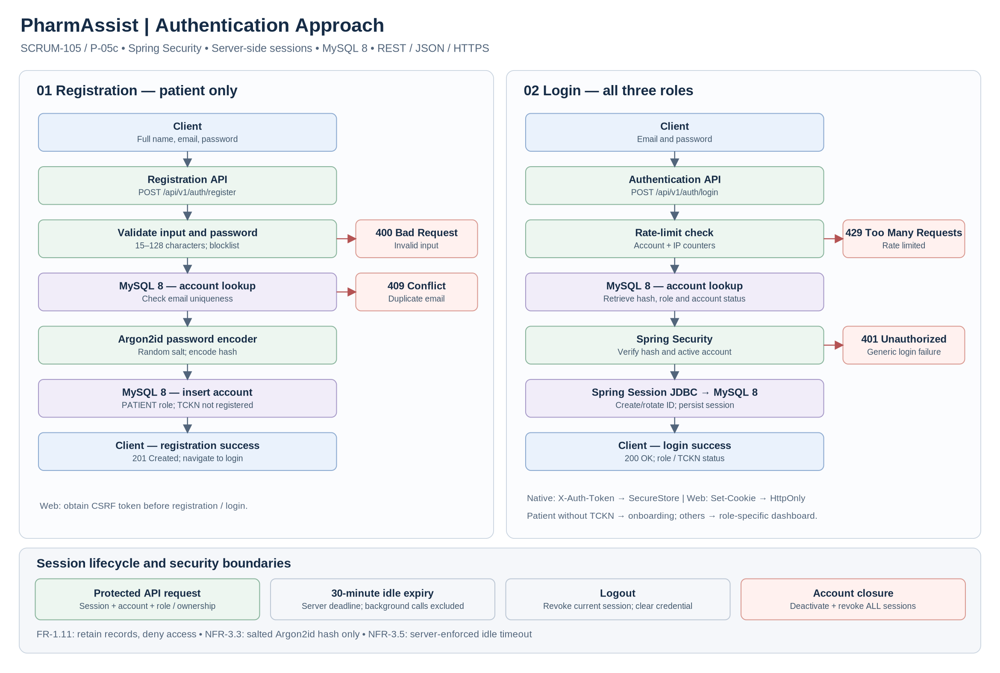

# PharmAssist — Authentication Approach

**Issue:** [SCRUM-105 (P-05c)](https://stu-team-mnqnew35.atlassian.net/browse/SCRUM-105)  
**Scope:** Design baseline for Sprint 5 authentication APIs; no implementation or test results claimed.  
**Architecture:** [SCRUM-48 (P-01)](https://stu-team-mnqnew35.atlassian.net/browse/SCRUM-48) · [Architecture PR #3](https://github.com/pharmassist-yu/pharmassist-backend/pull/3), AD-04, AD-05 and AD-08; Spring Boot modular monolith, React Native/Expo and MySQL 8.  
**Diagram:** [Registration and login flows](authentication.png) · [Editable Draw.io source](authentication.drawio)

**Summary:** Server-side JDBC sessions provide centralized revocation and a 30-minute user-idle deadline. Argon2id protects passwords; native clients use SecureStore and web clients use HttpOnly cookies with CSRF protection. Sprint 5 targets six authentication endpoints (including event-driven UI activity) and must validate same-origin web integration (OD-02). Full account-closure verification follows its later implementation.

## 1. Design decisions

| ID | Decision | Rationale |
|---|---|---|
| AUTH-01 | Server-side sessions with Spring Security, Spring Session JDBC and MySQL 8. | Central session expiry and revocation across devices; avoids additional JWT revocation infrastructure and a separate Redis deployment. |
| AUTH-02 | Argon2id via Spring Security `Argon2PasswordEncoder` and Bouncy Castle. | Adaptive, memory-hard salted password hashing; appropriate for a new application. |
| AUTH-03 | Native: Expo SecureStore and `X-Auth-Token`. Web: Secure HttpOnly session cookie and CSRF protection. | Native OS-backed storage and browser isolation from JavaScript reduce session-credential exposure. |
| AUTH-04 | 15–128 Unicode characters, no mandatory character classes; common/compromised password blocklist and rate limiting. | Supports passphrases, Turkish characters and password managers; limits guessing without arbitrary composition rules. |
| AUTH-05 | Three roles with Spring Security RBAC, method-level security and record-level checks. | Least privilege; role alone does not authorize access to arbitrary patient records. |
| AUTH-06 | Separate registration and login, current-session logout, account-wide deactivation and idle expiry. | Clear account lifecycle; no access to retained patient records after closure. |
| AUTH-07 | Versioned REST/JSON over HTTPS; six authentication endpoints in Sprint 5. | Shared frontend/backend contract and predictable error handling. |

## 2. Sessions and client storage (AUTH-01, AUTH-03)

- **Lifecycle:** Spring Session JDBC in Flyway-managed MySQL tables; index by stable account ID. Rotate session IDs on login. Check session, active account and authorization on every protected request. Logout revokes one session; closure revokes all. Coordinate concurrent login/closure and deny inactive accounts even if cleanup fails.
- **Idle deadline:** 30 minutes since the last server-accepted qualifying activity. Check before authorization or renewal; at >=30 minutes invalidate and return 401. Use server time and atomic monotonic updates. Exclude `/auth/me`, CSRF retrieval, polling, reminder sync and background requests; default request-based expiry alone is insufficient.
- **UI-only activity:** A foreground, visible client sends authenticated `POST /auth/activity` on user input (typing, taps/clicks or user-driven scrolling), at most once per 60 seconds; no unconditional timer or heartbeat. Send the first eligible event immediately; coalesce further events within the interval. No form content, key values, identifiers or client timestamp in the payload. The server validates the session/account and CSRF for cookie transport, then updates the deadline using server time; an expired session cannot be renewed. Throttling/network latency can make server-observed activity earlier than the last physical interaction. Offline or background activity cannot renew sessions; foreground resume checks validity without extending it. Client activity is a signal, not proof of human presence. On expiry clear credentials, require login and do not persist sensitive unfinished forms in insecure storage.
- **Native:** Expo SecureStore (Keystore/Keychain), `X-Auth-Token` over HTTPS; validate restored credentials, clear on logout/401. No AsyncStorage or persisted passwords. Offline sign-out alone does not revoke the server session.
- **Web:** Host-only session cookie (`HttpOnly`, `Secure`, `SameSite=Strict`, `Path=/`, no Domain/Max-Age); CSRF for state changes including login, register, activity and logout; refresh CSRF after login/logout. Never expose the session ID to browser JavaScript.
- **Transport:** Custom resolver; reject mixed credentials, isolate native/header and browser/cookie flows, restrict CORS and never waive cookie CSRF using a client-type claim alone. TLS 1.2+, `Cache-Control: no-store`; no credentials in URLs/logs or health data in session attributes.

**Hosting dependency — SCRUM-48 / OD-02:** Separate `onrender.com` hosts are cross-site (public suffix), incompatible with `SameSite=Strict` cookie authentication even with CORS. Prefer a single public HTTPS origin (same service or reverse proxy); use a same-origin HTTPS development proxy in Sprint 5. Same-site HTTPS custom subdomains are an alternative with credentialed CORS, host-only API cookies and CSRF checks. Final topology remains open; verify browser auth before integration acceptance. Do not weaken cookie policy.

## 3. Password policy (AUTH-02, AUTH-04)

| Setting | Selected baseline |
|---|---|
| Algorithm | Argon2id, Spring Security `Argon2PasswordEncoder` |
| Memory / iterations / parallelism | 19,456 KiB (19 MiB) / 2 / 1 |
| Salt / output | Random 16-byte salt per password; 32-byte hash |
| Storage | Logical `password_hash` field, `VARCHAR(255)` or compatible existing schema; encoded hash contains salt and algorithm parameters |
| Length | 15–128 Unicode code points; allow whitespace and Turkish characters; consistent Unicode handling at registration and verification; no silent truncation |
| Composition | No mandatory uppercase, lowercase, digits or symbols; no scheduled password changes; allow paste/password managers |
| Registration UI | Password confirmation and strength feedback; server validates the authoritative policy and blocklist; confirmation is client-side only |
| Guessing protection | Five failed attempts within 15 minutes trigger a 15-minute temporary block; account and IP limits, reset account failure count on successful login, no permanent lockout |

Apply the policy to all accounts; use a controlled blocklist without sending plaintext passwords externally. Store only salted encoded hashes; verify with `matches`. Never expose passwords/hashes in logs or responses. Rate-limit before hashing; use comparable processing and generic errors for unknown accounts. Benchmark selected Argon2id and rate-limit settings under expected load; performance is not yet measured.

## 4. Roles and authorization (AUTH-05)

| Role (API value / Spring authority) | Creation | Authorized scope |
|---|---|---|
| `PATIENT` / `ROLE_PATIENT` | Public registration; assigned only by server | Own account and health profile, medication search and assessments, reminders and intake history. TCKN registration required before health-profile features. |
| `HEALTHCARE_PERSONNEL` / `ROLE_HEALTHCARE_PERSONNEL` | Administrator creates account and assigns role | Search active patients by name/TCKN and view permitted health information read-only. No patient editing, medication search, risk/equivalent assessment or intake history. |
| `ADMIN` / `ROLE_ADMIN` | Controlled bootstrap, no public self-registration or committed default password | Personnel account provisioning and role assignment only; no patient health-profile access. |

Shared login; deny by default. Enforce endpoint/method authorization (`@PreAuthorize`), patient ownership and active target-account status for personnel. Reject client-supplied registration roles. UI routing is not authorization. Audit personnel access and security-sensitive operations without credentials or full patient records.

## 5. Registration, login and account lifecycle (AUTH-06)



**Registration:** client → validate full name, email, password and email uniqueness → Argon2id → MySQL inserts active PATIENT account without TCKN → 201 → login screen. Enforce database uniqueness; preserve inactive accounts. No automatic authenticated session. TCKN follows login (FR-1.12–1.15).

**Login:** client email/password → rate limit → MySQL lookup → verify hash and active status → create/rotate ID and persist security context/idle deadline → 200 with user metadata and transport-specific credential. Generic 401 for invalid credentials/inactive account; 429 for rate limit. Route by role and TCKN status; enforce TCKN onboarding gate at the API.

**Logout / expiry:** revoke the current session and clear the credential. At the idle deadline reject all subsequent requests, including activity signals; cleanup timing does not determine access validity.

**Account closure (later):** confirm intent, reverify password → deactivate and revoke all sessions with concurrency protection → deny login and patient/personnel access → retain historical records. Reactivation requires matching existing TCKN and verifying registered email (FR-1.15); fresh session only after verification and successful authentication. Old sessions remain invalid. Email provider and token expiry/retry remain open.

## 6. Sprint 5 API contract (AUTH-07)

Base: `/api/v1`, JSON over HTTPS; no session credential in JSON. Example values are synthetic. Web obtains CSRF token before login/register and refreshes after authentication or logout.

| Method / path | Request | Success | Access |
|---|---|---|---|
| `POST /auth/register` | `fullName`, `email`, `password` | 201: `message` | Public patient registration |
| `POST /auth/login` | `email`, `password` | 200: `userId`, `fullName`, `role`, `tcknRegistered` (patient); session ID via `X-Auth-Token` (native) or `Set-Cookie` (web) | Public, rate limited |
| `POST /auth/logout` | No body | 204, current session revoked; expire web cookie | Authenticated |
| `GET /auth/me` | No body | 200: `userId`, `fullName`, `email`, `role`, `tcknRegistered` (patient) | Authenticated; does not renew user-idle deadline |
| `POST /auth/activity` | No body | 204: qualifying activity accepted; update server idle deadline | Authenticated; CSRF for web; throttled client events |
| `GET /auth/csrf` | No body | 200: `headerName`, `token` | Web, available before and after login; does not renew user-idle deadline |

`tcknRegistered` is a patient-only boolean, not the TCKN. Align user ID type with schema/OpenAPI. Turkish messages and stable error codes. Synthetic examples:

```json
{"fullName":"Test User","email":"patient@example.com","password":"Example Password 2026"}
```

```json
{"code":"INVALID_CREDENTIALS","message":"Email veya parola hatalı."}
```

| Status | Meaning |
|---|---|
| 400 | Input validation failure |
| 401 | Invalid credentials, missing/expired/revoked session or inactive authenticated account |
| 403 | Insufficient permission or failed CSRF validation |
| 409 | Registration uniqueness conflict; generic message, no existing-account details |
| 429 | Rate limit exceeded; generic message and retry guidance |
| 500 | Unexpected error; no stack trace, SQL or secrets |

Use identical login errors for unknown email, wrong password and inactive account. Registration 409 still carries enumeration risk; return no account details, rate-limit registration and assess residual risk.

### Related endpoints (not all part of Sprint 5 authentication delivery)

| Proposed endpoint | Scope |
|---|---|
| `PUT /api/v1/profile/tckn` | Sprint 5 profile work; validation, uniqueness including inactive records, gated profile access |
| `POST /api/v1/auth/deactivate` | Later account closure and all-session revocation |
| `POST /api/v1/auth/reactivation/request` | Later registered-email verification initiation |
| `POST /api/v1/auth/reactivation/confirm` | Later verified reactivation |
| `POST /api/v1/admin/personnel` | Personnel provisioning under its related implementation issue |

Reactivation paths are conceptual; finalize token handling, protected onboarding, account transitions and enumeration controls in related work. No schedule changes.

## 7. Requirement coverage and planned verification

| Requirement | Mechanism and planned tests |
|---|---|
| **FR-1.11** | Inactive state, all-session revocation, per-request account and target-patient checks; retain records. Sprint 5: service-level revocation and inactive-account rejection with fixtures. Later: full two-device closure, login denial, personnel search/view denial, retention and concurrent login/closure. |
| **NFR-3.3** | Argon2id, independent random salt, encoded hash only. Inspect synthetic DB records, compare hashes for identical passwords, verify correct/wrong password and absence of credentials in logs/responses. |
| **NFR-3.5** | Server-side 30-minute qualifying-activity deadline. Test 29:59 vs 30:00, continuous UI-only form input, throttled activity, background/polling exclusion, offline/resume and rejection of activity on expired/revoked sessions. |
| Other security and functional requirements | Test registration/login/logout, role and ownership restrictions, TCKN gate/uniqueness, TLS, session rotation, CSRF, transport isolation, rate limits, native cleanup and same-origin web integration. Verify reactivation/personnel restrictions when those features exist. |

Use synthetic data (NFR-3.7). Full FR-1.11 end-to-end acceptance requires the later closure and personnel APIs; Sprint 5 verification is partial. No tests have been executed by this design note.

## 8. Implementation alignment and references

**Sprint 5 work items:** Under [SCRUM-52](https://stu-team-mnqnew35.atlassian.net/browse/SCRUM-52) / [SCRUM-53](https://stu-team-mnqnew35.atlassian.net/browse/SCRUM-53), estimate (1) dual resolver, CSRF and transport isolation; (2) JDBC migrations, custom server idle tracking, UI activity endpoint/client events, concurrency and boundary tests. Confirm allocation at sprint planning; no new Jira issues or story points assumed. Validate local same-origin HTTPS; production hosting via OD-02 / [SCRUM-89](https://stu-team-mnqnew35.atlassian.net/browse/SCRUM-89).

Related work: [SCRUM-51](https://stu-team-mnqnew35.atlassian.net/browse/SCRUM-51) registration, [SCRUM-54](https://stu-team-mnqnew35.atlassian.net/browse/SCRUM-54) personnel, [SCRUM-55](https://stu-team-mnqnew35.atlassian.net/browse/SCRUM-55) sensitive data, [SCRUM-106](https://stu-team-mnqnew35.atlassian.net/browse/SCRUM-106) schema. Confirm schema, dependency versions, blocklist and admin bootstrap during implementation; revisit MFA and absolute session lifetime before clinical use.

References: SoW §§6.5.1, 6.5.7, 6.6.3, 7, 11; MySQL 8 per SCRUM-102/48. Technical guidance (not compliance claims): [OWASP Password Storage](https://cheatsheetseries.owasp.org/cheatsheets/Password_Storage_Cheat_Sheet.html), [OWASP Session Management](https://cheatsheetseries.owasp.org/cheatsheets/Session_Management_Cheat_Sheet.html), [NIST SP 800-63B-4](https://pages.nist.gov/800-63-4/sp800-63b.html), [Spring Session](https://docs.spring.io/spring-session/reference/http-session.html), [HttpSessionIdResolver](https://docs.spring.io/spring-session/docs/current/api/org/springframework/session/web/http/HttpSessionIdResolver.html), [Public Suffix List](https://publicsuffix.org/list/public_suffix_list.dat), [Render custom domains](https://render.com/docs/custom-domains), [MDN Fetch credentials](https://developer.mozilla.org/en-US/docs/Web/API/Fetch_API/Using_Fetch#including_credentials), [Expo SecureStore](https://docs.expo.dev/versions/latest/sdk/securestore/).
